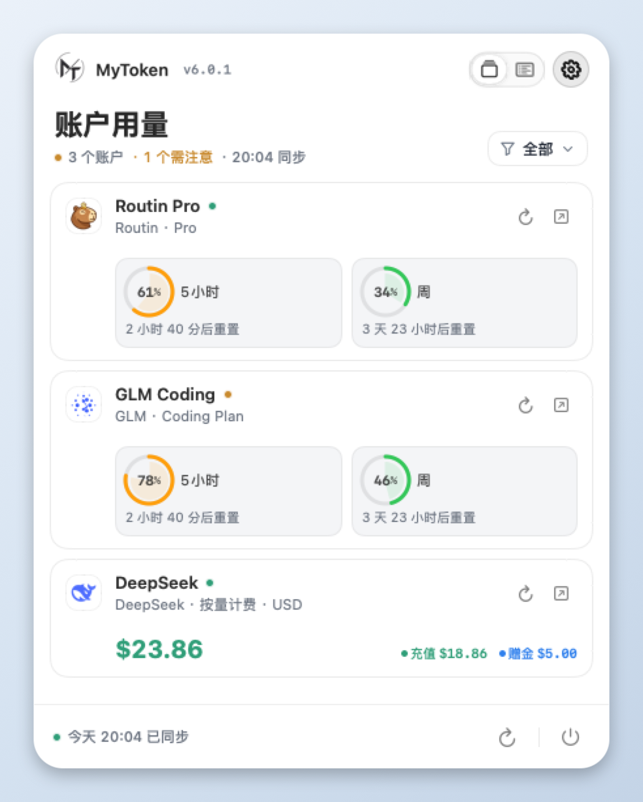
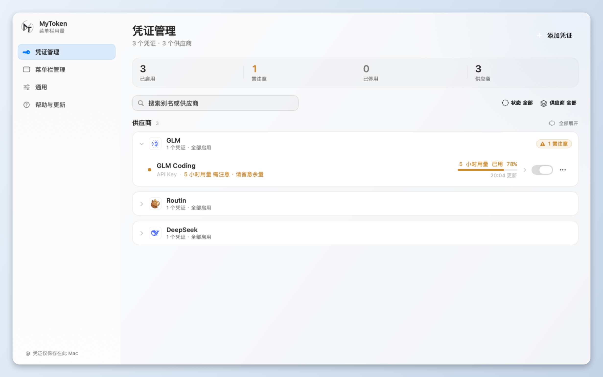

# MyToken

**把多个大模型服务的用量、余额和重置时间，收进 macOS 菜单栏。**

不用来回登录各家控制台。MyToken 在本机读取你保存的 API Key，定时请求各供应商接口，
把格式各异的返回统一成「已用 / 总量 / 剩余 / 重置时间」，在菜单栏常驻显示。
另有一款 Android 伴侣应用，可通过局域网扫码把 Mac 上的配置加密迁移到手机。

<p align="center">
  
</p>

<p align="center">
  
</p>

<p align="center">
  <sub>界面截图使用应用真实视图渲染，数据为演示用模拟数据。</sub>
</p>

## 特性

**菜单栏常驻**
- 最多同时显示 5 个凭证，每个显示供应商短码与竖向进度条，或百分比。
- 进度、余额、状态三类语义分开处理，只有余额接口的供应商不会被伪造出百分比。
- 按用量阈值自定义颜色规则，深浅色菜单栏都清晰。
- 左键打开用量弹窗，右键打开应用菜单。

**用量弹窗**
- 简洁 / 完整两种信息密度，一键切换。
- 供应商 Logo、环形用量图（2 项横排、3 项竖排）、余额大金额与充足 / 偏低 / 不足徽章。
- 占用较高时直接显示剩余时间，刷新中卡片边框播放流星动效。
- 刷新失败在头像右上角标红，点开看原因并单独重试，其余凭证不受影响。
- 深浅色主题自适应，使用 macOS 液态玻璃风格。

**多凭证与多供应商**
- 按供应商分组管理多个独立凭证，逐个启用、停用、编辑、连接测试、复制和排序。
- 支持 Bearer Token、独立 API Key、AccessKey ID / SecretAccessKey 三种凭证形态。
- 凭证字段按供应商动态生成，包含区域、自建接口地址、用户 ID 等。

**自动化**
- 自动刷新间隔 1 / 5 / 15 / 30 分钟可选。
- 按指标维度设置提醒阈值，全局默认告警线 80% 与 95%，同一刷新周期内不重复打扰。
- 登录时自动启动。
- 从 GitHub Release 检查更新，支持直连或 CDN 加速源，下载后自动安装并重启。
- 桌面小组件：单凭证组件与总览组件，可选指标与显示样式。

**迁移与诊断**
- 一键把凭证迁移到 Android：局域网直连、端到端加密、单次会话、用完即毁。
- 日志统一脱敏，可导出诊断日志，或生成预填的 GitHub Issue 草稿。

## 支持的供应商

| 供应商 | 凭证 | 展示内容 |
| --- | --- | --- |
| Routin | plan Key | 5 小时与每周用量、Token 包、订阅周期与重置时间 |
| DeepSeek | API Key | 账户余额、赠金余额、充值余额、账户可用状态 |
| 智谱 GLM Coding Plan | API Key | 5 小时与每周用量、模型调用量、MCP 调用量 |
| 火山方舟 | AccessKey ID + SecretAccessKey（可选区域） | Personal Agent Plan / Coding Plan 的 5 小时、周、月用量与重置时间 |
| New API | 接口地址 + 用户 ID + 访问令牌 | 账户额度、已用与剩余、Token 消耗、消费金额、RPM / TPM、累计请求 |
| Command Code | API Key | 余额、额度窗口与重置时间 |
| 小米 MiMo | API Key | `sk-` 读按量余额与近 31 天用量；`tp-` 读 Token Plan Credits 与周期 |
| OpenCode Go / Go Plus | Console service account Key | 账户级订阅用量与重置时间 |

指标语义按供应商能力声明，Token、货币、请求次数和账户状态不会被混成同一种单位。

## 安装

### macOS

1. 从 [Releases](https://github.com/dick86114/MyToken/releases) 下载 `MyToken.dmg` 或对应架构的安装包。
2. 打开 DMG，把 `MyToken` 拖入「应用程序」。
3. 启动后在设置里添加凭证。

要求 macOS 14.0 或更高版本。首次运行未签名版本时，macOS 可能拦截，
请到「系统设置 → 隐私与安全性」选择「仍要打开」。

### Android

Android 客户端要求 Android 10 及以上，通过「迁移到 Android」扫码接收 Mac 上的配置。
构建与模块结构见 [`docs/android/README.md`](docs/android/README.md)。

## 使用

- **左键**点击菜单栏图标：打开用量弹窗。
- **右键**点击菜单栏图标：设置、检查更新、导出诊断日志、提交问题、退出 MyToken。
- 弹窗右上角齿轮：打开独立设置窗口，包含凭证管理、菜单栏管理、通用、帮助与更新四个分栏。

凭证配置和密钥只保存在当前用户的本地存储中，不进入应用包，也不会提交到仓库。

## 隐私与安全

- 没有云端账号，不上传凭证，不做第三方遥测。
- 所有请求只发往你配置的供应商接口地址。
- 诊断日志、错误提示和 Issue 草稿都会脱敏，不包含完整密钥或请求头。
- Android 端密钥由 Android Keystore 加密，且排除在系统备份之外。
- 迁移过程密钥仅以密文经局域网点对点传输，二维码不含明文凭证。
- 卸载应用不会自动删除本地配置；如需彻底清除，请先在设置中删除所有凭证。

日志位置：`~/Library/Logs/MyToken/app.log`

## 技术栈

- **macOS**：Swift 5 + SwiftUI / AppKit，部署目标 macOS 14.0，XcodeGen 管理工程。
- **Android**：Kotlin 多模块（`core`、`data`、`domain`、`provider`、`feature-*`）。
- **共享契约**：`shared/` 存放迁移 schema、供应商能力矩阵和各供应商响应 fixture，两端共用同一份事实。

统一指标模型把「怎么显示」（进度 / 余额 / 状态 / 数值）和「是什么」（已用 / 剩余 / 余额）
分开，因此新增供应商只需实现一个 `UsageProvider`，不必改动视图层。

```
RoutinUsage/        macOS 应用源码
RoutinUsageWidget/  WidgetKit 小组件
RoutinUsageTests/   macOS 单元测试
android/            Android 客户端
shared/             跨端 schema、能力契约与 fixture
scripts/            测试、DMG 构建、Xcode 版本校验
docs/               首次运行说明、Android 文档与界面截图
website/            官网
```

## 本地开发

需要 Xcode 26 或更高版本、macOS 26 SDK 或更高版本，以及 XcodeGen：

```bash
brew install xcodegen
xcodegen generate
```

运行测试：

```bash
scripts/test.sh
```

构建未签名 DMG：

```bash
scripts/build-dmg.sh
```

产物位于 `build/dist/MyToken.dmg`，构建脚本会先校验 Xcode 与 SDK 版本。

Android：

```bash
cd android
./gradlew test                 # 全模块 JVM 单元测试
./gradlew :app:assembleDebug   # 构建 Debug APK
```

## CI 与发布

- `ci.yml`：push 与 PR 触发，使用 Xcode 26.3 跑完整测试并上传 DMG 产物。
- `android-ci.yml`：`android/` 变更时触发，跑全模块 JVM 测试并编译 instrumented 测试。
- `release-macos.yml` / `release-android.yml`：手动触发，填写版本号与发布说明，
  自动创建标签、生成 GitHub Release 并上传构建产物。

## 贡献

欢迎提交 Issue 和 Pull Request。请从 `master` 创建分支，提交信息使用
[Conventional Commits](https://www.conventionalcommits.org/)（如 `feat:`、`fix:`、`docs:`），
并确保 CI 通过。

新增行为请在 `RoutinUsageTests/` 补充对应测试；不要在日志、测试夹具或提交内容中放入真实 API Key。

## 许可证

本仓库目前未声明开源许可证。未经项目维护者许可，请不要再发布代码或构建产物。
