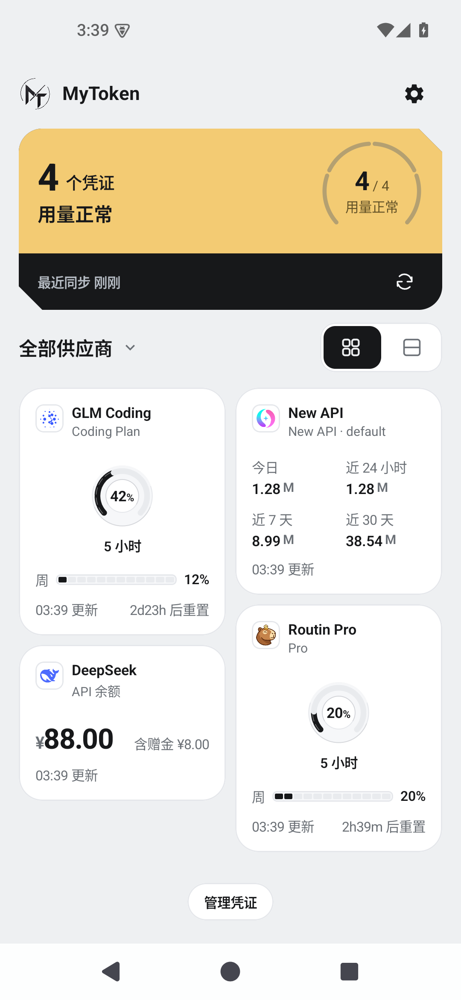
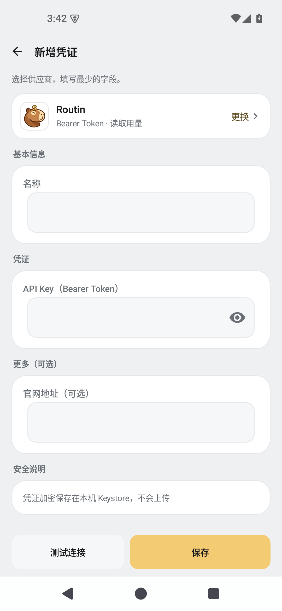
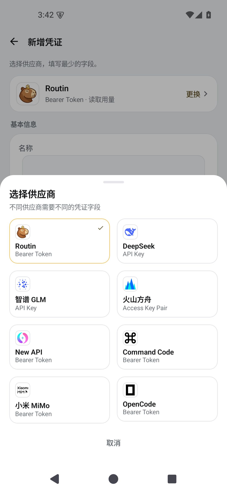
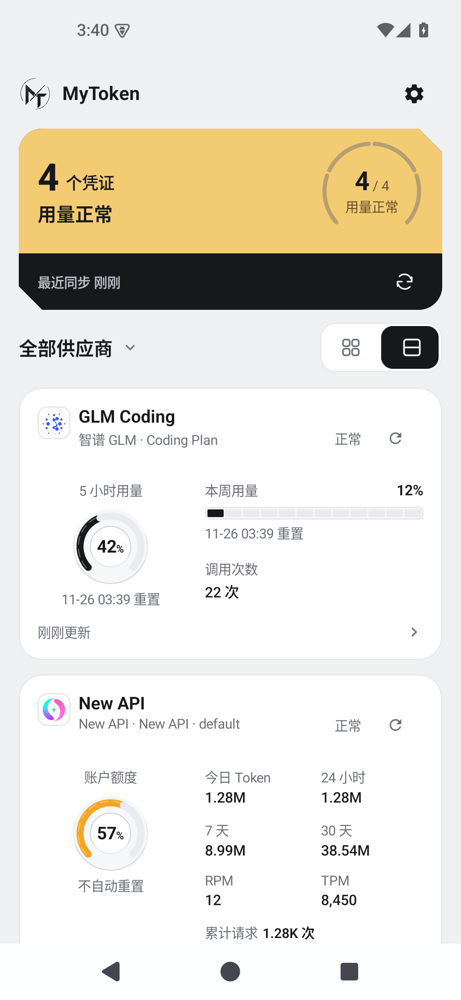
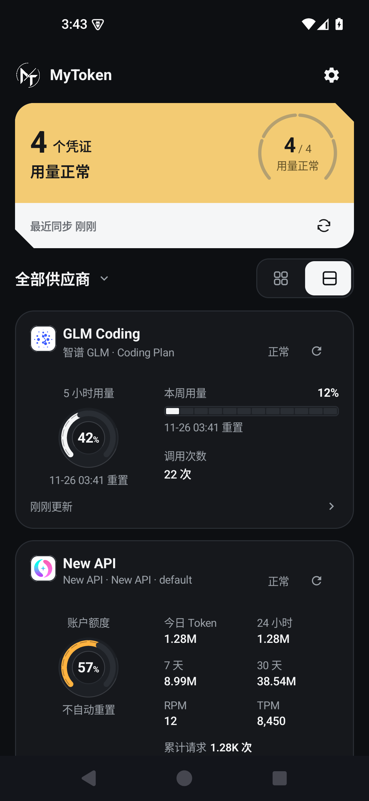
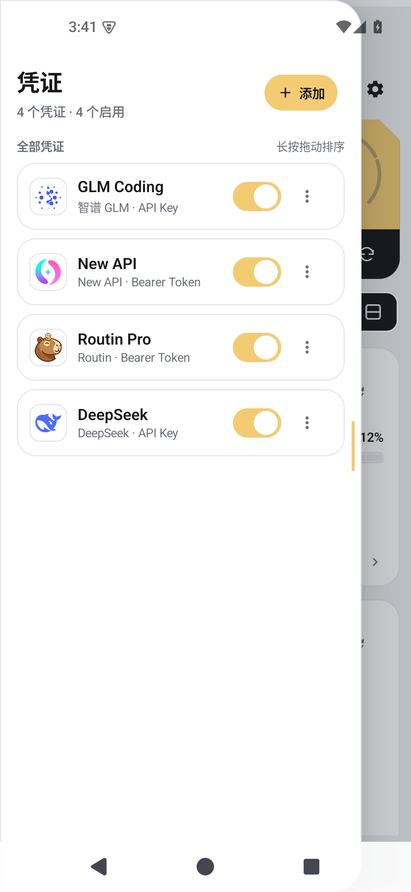
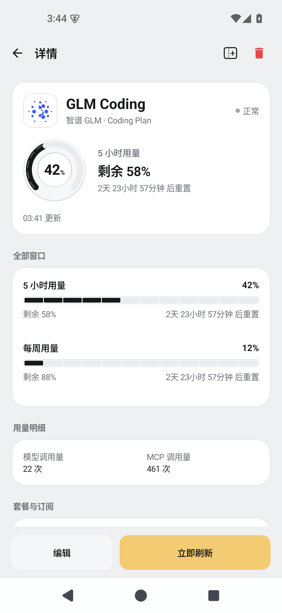
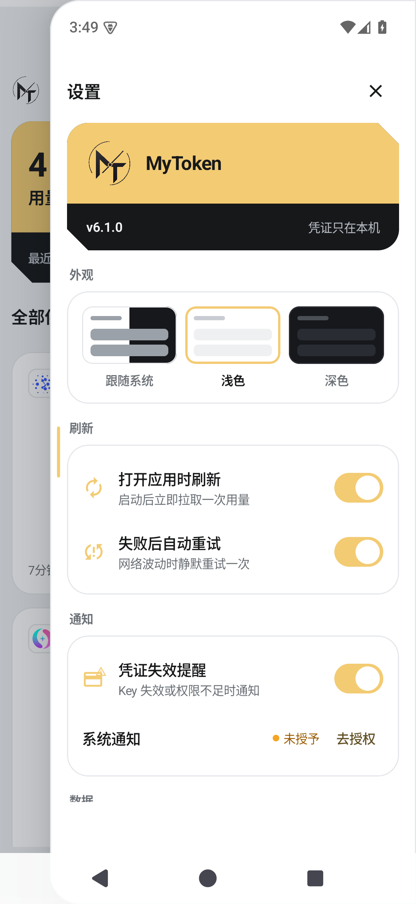

# MyToken Android 使用手册

MyToken Android 是 macOS 菜单栏用量监控工具的移动端伴侣应用。它把你在 Mac 上已经
管理好的大模型凭证带到手机上，让你随时查看各家服务的用量、余额、剩余额度和重置时间。

所有凭证都只保存在手机本地（Android Keystore 加密），不上传云端，也没有账号体系。

## 目录

1. [安装](#1-安装)
2. [第一次打开：导入凭证](#2-第一次打开导入凭证)
3. [首页怎么看](#3-首页怎么看)
4. [管理凭证](#4-管理凭证)
5. [卡片详情](#5-卡片详情)
6. [设置](#6-设置)
7. [桌面小组件](#7-桌面小组件)
8. [常见问题](#8-常见问题)
9. [隐私与安全](#9-隐私与安全)

## 1. 安装

**系统要求**：Android 10（API 29）或更高版本。

1. 打开 [Releases](https://github.com/dick86114/MyToken/releases)，下载最新正式版
   `MyToken-<版本>-android.apk`。
2. 在手机上打开安装包，按系统提示允许「安装未知来源应用」。
3. 安装完成后打开 MyToken。

如果只是想尝鲜，可以安装带 `preview` 的预览版；预览版不参与应用内更新，
需要手动下载新版本覆盖安装。

## 2. 第一次打开：导入凭证

首次打开时凭证抽屉是空的，有两种方式添加凭证。

### 2.1 从 Mac 扫码迁移（推荐）

1. 在 Mac 的 MyToken 菜单里选择「迁移到 Android」，屏幕会显示一个二维码和倒计时。
2. 在手机上打开左侧凭证抽屉，点「从 Mac 导入」，首次使用会请求相机权限。
3. 把手机对准 Mac 屏幕上的二维码。识别成功后会自动连接同一局域网内的 Mac，
   显示「确认导入」预览。
4. 确认后凭证一次性加密传输到手机，Mac 端的迁移通道随即关闭。

迁移使用局域网直连和端到端加密，二维码只用于建立一次性会话，不包含明文凭证。
二维码有时效（约 5 分钟），过期后需要在 Mac 上重新生成。

> 迁移需要手机和 Mac 处于同一局域网，且 Mac 的防火墙允许本地网络连接。
> 扫码失败的处理办法见 [`transfer-troubleshooting.md`](transfer-troubleshooting.md)。

### 2.2 手动添加

也可以只添加一两个凭证：

1. 打开左侧凭证抽屉，点右上角「添加」或空状态里的「手动添加」。
2. 在「选择供应商」里挑一家服务商。
3. 按表单填写名称和凭证字段。不同供应商需要的字段不同：

| 供应商 | 必填字段 | 备注 |
| --- | --- | --- |
| Routin | Bearer Token | 需要 `plan-` 开头 |
| DeepSeek | API Key | 只读余额，不消耗额度 |
| 智谱 GLM | API Key | 读取 Coding Plan 的 5 小时 / 每周用量 |
| 火山方舟 | Access Key ID + Secret Access Key | 可选区域，默认 `cn-beijing` |
| New API | 接口地址 + 用户 ID + 访问令牌 | 支持自建实例 |
| Command Code | API Key | — |
| 小米 MiMo | API Key | `sk-` 读按量余额，`tp-` 读 Token Plan |
| OpenCode | Console API Key | — |

4. 填完可以点「测试连接」确认字段有效，再点「保存」。

  

凭证保存在本机 Keystore 中，界面上只显示掩码，不会上传到任何服务器。

## 3. 首页怎么看

首页由一块健康面板和一组供应商卡片组成。

### 3.1 健康面板

- 左侧显示凭证总数和当前状态：全部正常时显示「用量正常」，有失败或额度告警时
  显示相应提示。
- 右侧环形显示正常凭证比例，例如 `4 / 4`。
- 下方面板列出需要处理的凭证（没有异常时只显示同步时间），点「刷新」图标可手动
  拉取全部凭证。
- 面板会随手势收起：向下滚动时变成一行紧凑标题，方便快速回到顶部。

### 3.2 列表与网格

右上角的两个图标切换两种密度：

- **列表**：一行一张卡，信息最全，适合逐张阅读。
- **网格**：两列紧凑卡，一屏看到更多账户，适合快速扫一眼。

两种密度都支持浅色和深色主题，在设置里切换，或跟随系统。

  
  
  

### 3.3 供应商筛选

点「全部供应商」可以只看某一家供应商的卡片。筛选只影响首页显示，不会改动凭证本身。

### 3.4 怎么读一张卡

每张卡固定按「身份 → 主指标 → 次级指标 → 明细 → 页脚」组织：

- **身份区**：供应商 Logo、凭证名称、套餐或计费方式。右上角是状态：「正常」
  「接近上限」「已用完」或「更新失败」。
- **主指标**：配额型显示环形百分比（如 5 小时用量 42%）；余额型显示大号金额。
- **次级指标**：每周用量、调用次数、Token 消耗等，用分段 LED 条或数字呈现。
- **页脚**：最近更新时间、重置倒计时，点整张卡进入详情。

环形和进度条的颜色只表示用量健康度：正常为中性色，接近上限为琥珀色，
超限为红色。数字使用等宽字形，方便纵向比较。

## 4. 管理凭证

点首页左上角的 Logo 打开凭证抽屉：

- **启停**：右侧开关控制某个凭证是否参与首页显示和自动刷新。
- **排序**：长按拖动可以调整卡片顺序。
- **编辑 / 删除**：点行尾的 `⋮`，选择「编辑」或「删除」。删除只影响手机本地，
  不会改动供应商账户。
- **添加**：右上角「添加」随时新增凭证。
- **统计**：标题下方显示凭证总数和启用数量。

## 5. 卡片详情

点任意卡片进入详情页：

- 顶部是完整的主指标、重置倒计时和最近更新时间。
- **全部窗口**：5 小时、每周、每月等每个配额窗口的用量、剩余和重置时间。
- **用量明细**：模型调用次数、MCP 调用、Token 消耗等。
- **套餐与订阅**：套餐名称、计费方式、到期日；余额型供应商显示余额构成。
- 底部操作：编辑、立即刷新。部分供应商还支持分享用量卡片和每日签到。

## 6. 设置

点首页右上角齿轮打开设置抽屉：

- **外观**：跟随系统 / 浅色 / 深色。
- **刷新**：打开应用时自动刷新；失败后静默重试一次。
- **通知**：凭证失效提醒，以及系统通知权限入口。
- **数据**：从 Mac 导入、导出诊断日志。
- **关于与更新**：版本号和应用内更新检查。

首次使用通知提醒时，需要允许「系统通知」权限；否则失败告警只会在应用内显示。

## 7. 桌面小组件

MyToken 提供单凭证桌面小组件：

1. 长按桌面空白处，选择「小组件」。
2. 找到 MyToken，把组件拖到桌面。
3. 长按已添加的组件，点设置图标，选择要展示的凭证。

小组件会跟随应用内的刷新节奏更新，刷新失败时保留上一次成功的数据。

## 8. 常见问题

**为什么卡片显示「更新失败」？**

先点卡片上的刷新图标重试。持续失败时检查：凭证是否被供应商吊销、Key 是否过期、
网络是否可达该供应商。失败时卡片会保留上一次成功的数据，并标注更新时间。

**为什么刷新数据更新了，但时间没变？**

首页展示的是最近一次成功同步时间。可以点健康面板里的刷新图标手动同步，
或在设置里确认「打开应用时刷新」已开启。

**扫码一直识别不了？**

确认 Mac 端二维码没有过期；调高手机屏幕亮度、让二维码完整落在取景框内；
确认手机和 Mac 在同一个 Wi-Fi。仍不行可以在 Mac 上重新生成二维码再试。

**通知收不到？**

到系统设置里确认 MyToken 的通知权限已开启，并在应用设置里打开「凭证失效提醒」。
省电策略较强的系统（如 OriginOS）还需要允许 MyToken 后台运行。

**卸载应用会删除凭证吗？**

会。凭证只保存在本机 Keystore 中且不参与系统备份，卸载后无法恢复。需要保留时，
请先在 Mac 端保留原始凭证，或重新扫码迁移。

## 9. 隐私与安全

- 没有云端账号，不上传凭证，不做第三方遥测。
- 请求只发往各供应商的官方接口；只有 New API 会发往你填写的接口地址。
- 凭证使用 Android Keystore 加密，排除在系统备份之外。
- 从 Mac 迁移时，凭证只在局域网内以密文点对点传输，二维码不含明文凭证。
- 诊断日志在导出前会脱敏，不包含完整 Key 或请求头。

---

截图使用 MyToken 6.1.0 Debug 版在 390dp 宽度下实际渲染，数据为演示用模拟数据。
